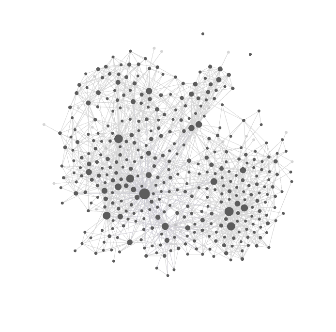
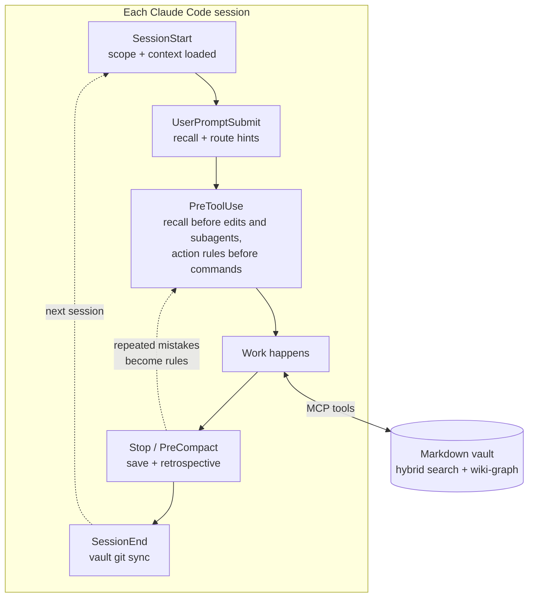

# 🧠 Symbiosis Brain

> **Stop re-explaining your project to Claude. Make it remember. Build your symbiosis.**

A memory for your coding agent that learns on the job. A markdown brain that lives next to your code, hooks that put the right note in front of the agent at the moment it acts, and skills that turn a mistake it keeps repeating into a rule that warns it next time. Local, file-based, Obsidian-compatible. Built for Claude Code — not locked to it.

[](https://pypi.org/project/symbiosis-brain/)
[](https://pypi.org/project/symbiosis-brain/)
[](LICENSE)

---

## Choose your client

The published **0.7.1** release automatically installs the Claude Code
integration and adds the OpenCode and Codex support described below. Install
`symbiosis-brain==0.7.1` from PyPI for these adapters; older packages do not
contain them.

All three integrations use the same vault format, MCP tools, project/global
memory semantics and hybrid search. Client-specific instructions only bridge
native tools and lifecycle events; they do not create separate memory systems.

| Capability | Claude Code | OpenCode | Codex |
| --- | --- | --- | --- |
| Automatic context and experience recall | Hooks | Server plugin; hints reach the next applicable model request | Native hooks |
| Canonical Brain skills | Installed by setup | Packaged skills path and command wrappers | Semi-manual native skill installation |
| Durable learning | Save skill and MCP writes | Same skill and MCP writes; soft checkpoint reminders | Same skill and MCP writes; Stop reminders |
| Context-percentage save reminders | Claude integration | Not promised | Not provided |
| Brain status UI | Shell status line | Separate minimalist TUI plugin | Native Codex status items; no custom Brain widget |
| Client setup | Automatic | Automatic adapter setup | Documented semi-manual setup; automatic installer deferred |
| Vault Git synchronization | Separate packaged command | Visible placeholder; Git sync deferred | Separate manual command; not MCP index refresh |

An automatic hint is not a guarantee that a model will follow it. Saving useful
knowledge remains an agent action through the skill and MCP; compaction alone is
not a durable vault save. OpenCode does not cancel ordinary tools to force a
memory retry, and does not promise a hard Stop/PreCompact replica.

- **Claude Code:** follow the existing quick start below.
- **OpenCode:** see [the adapter guide](opencode/README.md) for supported versions,
  Node requirements, installation, restart, diagnostics and safe removal.
- **Codex:** see [manual setup](docs/codex-quickstart.md). It includes first-vault
  preparation, MCP and hooks, shared skills, validation, updates and disabling;
  there is no automatic `setup codex` command in this release scope.
- **Another MCP client:** use the generic MCP instructions below. MCP storage
  access alone does not install automatic recall or the skill workflow.

Client-neutral preparation in 0.7.1:

```bash
symbiosis-brain init-vault --vault /path/to/vault
symbiosis-brain resources --skills
```

The first command prepares the vault structure without installing a client. It
preserves existing notes and adds the standard vault metadata. The second only
prints the packaged canonical skills directory; it does not copy, replace or
remove user files. Claude Code does not need to be installed to use the other
clients. Follow the native client guide for tool names, skill discovery and
configuration, and do not overwrite a different existing skill with the same
name without reviewing the difference.

## What changes

You stop saying *"Hi Claude, my stack is X, last week we decided Y…"* every session. Claude remembers your stack, your projects, your past decisions. A lesson you wrote down comes back when the agent goes to edit the same file — **before** the edit, not after. A mistake it keeps making becomes a rule that warns it before the next one. Knowledge flows between repos. A hook stops `/compact` once, so the session is saved before it gets swallowed.

Week by week the vault stops being a notebook and becomes the working memory of an assistant that knows your projects, your conventions — and the ways it has been wrong before.

<p align="center">
  
  <br>
  <em>368 notes, 431 entities, all wiki-linked — the first few weeks of real work. The same vault is past 1,700 notes today. This is what your head looks like when you're juggling five projects at once. Don't panic — Claude knows exactly where to look.</em>
</p>

## Install (30 seconds)

```bash
uv tool install symbiosis-brain
symbiosis-brain setup claude-code
```

That's it. Restart Claude Code — `brain-welcome` introduces itself, asks two friendly questions, and you're done.

<details>
<summary><b>Don't have <code>uv</code>? Or prefer installing straight from GitHub?</b></summary>

**Install `uv` first** (one-time, ~30 seconds — `uv` is a fast Python package manager):

```powershell
# Windows (PowerShell)
powershell -ExecutionPolicy ByPass -c "irm https://astral.sh/uv/install.ps1 | iex"
```
```bash
# macOS / Linux
curl -LsSf https://astral.sh/uv/install.sh | sh
```

**Install Symbiosis Brain straight from GitHub** (no PyPI involved):

```bash
uv tool install git+https://github.com/Krill113/symbiosis-brain.git
symbiosis-brain setup claude-code
```

Same result — installs the latest `main` branch directly from the repo. Useful if you want to track unreleased changes or install from a fork.

</details>

> 🤖 **Want Claude Code to install it for you?**
> Paste this prompt:
>
> > *Install Symbiosis Brain from https://github.com/Krill113/symbiosis-brain — use the default vault path, then remind me to restart Claude Code.*
>
> Claude will read this README, run the install with `--vault ~/symbiosis-brain-vault`, and tell you when it's time to restart. **You'll need to restart Claude Code manually** — the running session can't pick up its own new MCP server until you do.

> 🤝 **Augments Claude Code — never overrides it.**
> Symbiosis Brain *adds* a memory layer. Every built-in Claude Code feature keeps working. Your existing hooks, skills, slash commands, and settings stay intact — we deep-merge our config with a `.bak` backup, and `symbiosis-brain uninstall` restores everything.

---

## It learns on the job

Most memory tools store what the agent chose to write down, then hope it looks. Symbiosis Brain closes the loop — and every step below is a hook or a skill you can read in this repo.

**1. Recall at the moment of action.** Before an edit, a write or a subagent launch, the `PreToolUse` hook searches the vault with the tool's own arguments — the file name and the head of the edit, the subagent's prompt — and puts what it finds in front of the agent as `[recall: N hits]`. A subagent gets routing hints matched against its own prompt: the memory a subagent needs most is the memory it never had.

**2. Mistakes and corrections are notes of their own.** `mistake` and `feedback` sit next to `decision`, `pattern` and `research` as first-class note types, and they are found by the same recall — so a lesson recorded against a file comes back the next time the agent is about to change it.

**3. A retrospective when the work is done.** At the end of a session, `brain-save` asks itself: which paths were dead ends, which way of working paid off, where did the user have to step in and redirect — and writes the answers down as `mistake`, `pattern` and `user` notes. Most sessions produce nothing, and that's fine.

**4. Repetition becomes leverage — `brain-autolearn`.** Rule of three: one occurrence is noise, two is a candidate, three is a signal. What isn't ripe yet waits in an inbox with a counter. When something is:

| What repeated | What it becomes | Who decides |
|---|---|---|
| a mistake shaped like a command | an **action rule** — a pattern on Bash / PowerShell commands that warns the agent before the command runs | done, then reported to you |
| a mistake that needs judgment | a patch to the existing `feedback` / `pattern` note | done, then reported to you |
| an action with no judgment inside | a **script** | done, then reported to you |
| an action that needs judgment | a **skill** draft, tested with and without the skill | installed on your OK |
| something bigger than a script or a skill | a **proposal** | you |

Every artifact gets a trigger in tool routing, so it surfaces when it applies — an artifact nobody recalls is just a second vault of forgotten things. And some things are deliberately never learned: quirks of one machine, errors that went away on their own, and "tool X is broken" — a claim like that hardens into a refusal long after the tool is fixed.

**The agent starts with zero action rules.** The shipped routing catalog carries seven tool hints and not a single command rule. Every rule in your install grows out of your own work.

**5. It shows whether recall helped.** Every search is logged locally, and `brain_report` shows which notes get opened after they surface — and which keep surfacing and are never read, so noisy memory is visible instead of quietly eating context.

## Beyond Claude Code

Symbiosis Brain is built for Claude Code and fully wired into it: one `setup` command installs the MCP server, the hooks and the skills.

The memory itself is not locked to it. The server is a standard stdio MCP server, and its 14 `brain_*` tools work from any MCP client on the same vault — search, read, write and the wiki-link graph. Register `symbiosis-brain serve --vault <path>` with your client. Generic MCP registration alone does not install automatic recall. The published 0.7.1 setup targets Claude Code and adds the OpenCode plugin and native Codex hooks described in [Choose your client](#choose-your-client).

## Why a markdown brain?

- 📂 **Your knowledge, your files.** Plain `.md` in a folder you pick. Human-readable, git-trackable, opens in Obsidian as a graph.
- 🔍 **Hybrid search, all local.** FTS5 + vector (sqlite-vec + fastembed), no API key — memory calls don't add an API bill on top of your agent. The embedding model is switchable, with a multilingual one registered for vaults not written in English.
- 🔗 **Wiki-links connect your projects.** `brain_context` walks the graph N hops — decisions in one repo surface as context in another.
- ⏰ **Bi-temporal.** Every fact carries `valid_from` / `valid_to`. Old knowledge gets a staleness warning; a note you close stops being injected as current, and search still finds it.
- 🗂️ **Scoped per project.** Notes are tagged to a project scope; global notes always ride along. Switch repos and the hooks pick up the right scope on their own — from a one-line marker in `CLAUDE.md`.
- 🪶 **Quiet by design.** No Clippy, no nag. Hooks fire only when they earn the interruption (e.g., context at 35% → "save before /compact swallows this").
- 🧩 **Skills shipped, not just storage.** `brain-init`, `brain-recall`, `brain-save`, `brain-autolearn`, `brain-tools` make the agent *use* the memory and learn from it — not pray that it does.
- 🪝 **Hooks make it automatic.** Seven session-lifecycle events are wired by the installer — recall fires before you ask, saves happen before context is lost.
- 🧭 **Tool routing.** Every prompt, a lightweight engine matches intent against a catalog of tool hints and injects `[route]` advice — so the agent reaches for the right tool (Serena for symbols, Playwright for JS-heavy pages, PowerShell on Windows) without manual prompting. `/brain-tools` onboards your own MCP servers.
- 🤝 **Layered, never invasive.** Adds capability without disabling any of Claude Code's defaults. Uninstall is one command.

## What it feels like

```text
You:    Continue from where we left off yesterday.

Claude: [brain-recall fires silently]
        I see we paused on the auth migration after deciding to
        skip JWT rotation — the blocker was the legacy refresh
        token format. Pick up there?
```

Same vault, days apart, different process. No prompt engineering, no copy-pasting context. The skill `brain-recall` fired on its own because the request triggered it.

## How it works (60 seconds)

A tiny MCP server backed by a folder of markdown notes. SQLite indexes them with FTS5 + vector search (sqlite-vec + fastembed); wiki-links form a graph; seven bash hooks wire the recall / learn / save loop into Claude Code's own session lifecycle.



**MCP tools (14):** `brain_search`, `brain_read`, `brain_write`, `brain_append`, `brain_patch`, `brain_context`, `brain_list`, `brain_status`, `brain_sync`, `brain_lint`, `brain_rename`, `brain_delete`, `brain_rotate_handoffs`, `brain_report`. The `brain_report` text, the `[dedup]` hint on `brain_write` and the Stop reminders are Russian for now. The default routing triggers are oriented toward Russian prompts; use `brain-tools` to configure triggers for your language. Localizing the built-in text is on the backlog.

**Skills (8):** `brain-init` (session bootstrap + scope resolution), `brain-recall` (pre-task memory search), `brain-save` (write + retrospective self-scan), `brain-autolearn` (repetition → action rule / script / skill / proposal), `brain-tools` (tool-routing onboarding), `brain-welcome` (first-run setup), `brain-project-init` (new-project onboarding), `brain-backfill-gists` (hygiene backfill).

**Hooks (7 events, all bash):**
- `SessionStart` — scope resolution, server prewarm, MCP roster cache
- `UserPromptSubmit` — hybrid recall + tool-route hints, injected as `[memory: N hits]` / `[route]`
- `PreToolUse` — pre-action recall before Edit / Write / Task / Agent / MultiEdit / NotebookEdit, route hints for a subagent's prompt, plus instant action-rule warnings on Bash / PowerShell commands
- `PostToolUse` — records the context % at the moment memory was written, so the `Stop` delta-guard measures growth since the last save
- `Stop` — context-threshold save reminder (default zones 25 / 35 / 45%)
- `PreCompact` — blocks compaction once for a last-chance save
- `SessionEnd` — vault git sync

**Every search is logged locally.** Every hit list the memory produces — from the MCP tools and from
the hooks alike — goes into a pair of tables inside your own `<vault>/.index/brain.db`, together
with the query, the number of hits and how long the hook took end to end. The query is stored in
full (on the hook path, that means your prompt text), truncated to 2000 characters. Messages that
reach the prompt hook from the harness rather than from you — another session, a task notification
— are labelled as such. The log never leaves your machine, it is what `brain-cli report` and
`brain_report` read, and it is rotated after 90 days. Two switches turn it off:
`SYMBIOSIS_BRAIN_RETRIEVAL_LOG=off` in the environment (server and hooks), or
`"retrieval_log_enabled": false` in `~/.claude/symbiosis-brain-pre-action.json` (hooks only). The
environment variable wins over the file.

**Every note the product writes is signed.** New and rewritten notes carry a `written_by:` line in
their frontmatter — client and version, model, date. It records **who last wrote the note through the product**, not who thought it up: `brain_append` and `brain_patch` rebuild the frontmatter too,
so the line always names the most recent write. Notes written before this was introduced carry no
such line, and none is invented for them.

You write nothing manually. The vault grows as you work.

## Why this, not…

- **Claude Code's own memory (`CLAUDE.md`, auto-memory)** — keep it; Symbiosis Brain runs beside it and switches nothing off. What it adds: search across thousands of scoped, dated notes, recall pushed in at the moment the agent acts, and a loop that turns repeated mistakes into rules.
- **basic-memory** — closest in spirit (markdown + Obsidian). Where we put the weight: recall pushed in at the moment the agent acts — before edits and subagents — a loop that turns repeated mistakes into rules, and tool routing.
- **mem0 / Letta** — a different category: memory infrastructure and agent frameworks you build on. We're local-first memory for the agent you already use.

## Configuration

The installer seeds a behavioural env block in `~/.claude/settings.json` (non-clobbering — your existing values are preserved).

| Variable | Default | What it does |
|---|---|---|
| `SYMBIOSIS_BRAIN_VAULT` | `~/symbiosis-brain-vault` | Path to your vault folder |
| `SYMBIOSIS_BRAIN_TOOLS` | *(install path)* | Path to the installed package (for `uv run` in hooks) |
| `SYMBIOSIS_BRAIN_SCOPE` | *(auto from cwd)* | Active project scope; overridden by the `CLAUDE.md` marker |
| `SYMBIOSIS_BRAIN_SAVE_THRESHOLDS` | `25,35,45` | Context % levels that trigger save reminders |
| `SYMBIOSIS_BRAIN_SAVE_DELTA_GUARD` | `10` | Minimum % change since last save before re-triggering |
| `SYMBIOSIS_BRAIN_RECALL_ENABLED` | `true` | Toggle UserPromptSubmit memory recall |
| `SYMBIOSIS_BRAIN_RECALL_TOP_K` | `5` | Max hits returned per recall |
| `SYMBIOSIS_BRAIN_ROUTING_MODE` | `decompose` | Tool-routing output mode (splits discipline vs tool hints) |
| `SYMBIOSIS_BRAIN_RULES_ENABLED` | `true` | Toggle the periodic tool-roster reminder |

Three more variables tune Stage 2 telemetry but are **not** seeded by the installer — their
defaults below apply with no entry written to `settings.json`, and you only need to set them if
you want something other than the default:

| Variable | Default | What it does |
|---|---|---|
| `SYMBIOSIS_BRAIN_RETRIEVAL_LOG` | `on` | Local search log in `<vault>/.index/brain.db`; `off` disables it in both the server and the hooks |
| `SYMBIOSIS_BRAIN_DEDUP_MIN` | `0.5` | Overlap threshold for the `[dedup]` hint on `brain_write`; `0` turns the hint off entirely |
| `SYMBIOSIS_BRAIN_DEDUP_MAX_SHOWN` | `2` | How many similar notes the hint may name; `0` also turns it off |

## Maintenance

```bash
symbiosis-brain doctor                       # health check
symbiosis-brain setup claude-code --repair   # fix only what's broken
symbiosis-brain uninstall                    # restore settings, vault preserved
```

### Upgrading

Four steps, in this order:

1. **Close every Claude Code window.** On Windows a running `symbiosis-brain serve` holds the executable, and the upgrade fails with `os error 32`.
2. `uv tool upgrade symbiosis-brain`
3. `symbiosis-brain setup claude-code --repair` — upgrading the package does not touch `~/.claude/hooks` or `~/.claude/skills`. Without the repair, a release's new hooks and skills never arrive.
4. `symbiosis-brain doctor` — then start Claude Code again.

Anything else worth knowing before a particular upgrade is in that release's notes, under [`docs/release-notes/`](docs/release-notes/).

## FAQ

**Is my knowledge private?** Yes. Everything is local files + a local SQLite index: no cloud service, no telemetry, no API key. Two things touch the network, both under your control: the embedding model's weights are downloaded once, on first use; and if your vault is a git repository with an `origin` remote, the session-end hook commits and pushes it there. No remote, no push.

**Will this break my Claude Code setup?** No. Symbiosis Brain layers **on top of** Claude Code — it never disables built-in features, overrides your hooks, or removes your existing skills. Config is deep-merged with a `.bak` backup. `uninstall` restores everything.

**Can I open the vault in Obsidian?** Yes — that's a first-class use case. The welcome flow can install Obsidian for you and open your first note as a graph.

**Does it work with other AI agents?** Yes. Any MCP client gets the tools and vault. Automatic recall additionally requires a client adapter: Claude Code hooks, the OpenCode plugin or Codex hooks. Release availability and setup differ; see [Choose your client](#choose-your-client).

**Does it learn things I didn't ask for?** It learns only from repetition — three times, not once — and anything bigger than a small, reversible fix waits for your OK. What it made is reported in one line: what, why, where it lives, what triggers it. See [It learns on the job](#it-learns-on-the-job).

**I pulled notes from another machine — why doesn't search see them?** Keyword search does, as soon as the next recall runs: the hooks re-sync the vault on every call. The vector half is maintained by the server, so semantic matches for those notes arrive after `brain_sync` or a restart of Claude Code.

**Windows: a note that never gets indexed?** Unless long paths are enabled, Windows can't open a file whose full path — the vault folder plus the note's path inside it — is longer than 260 characters. The note is seen but can't be read: a new one never enters the index, an indexed one keeps its old content. `brain_sync` names it under `failed`, and a new one also shows up as not indexed in `brain_lint`. Enable long paths in Windows (`LongPathsEnabled`, the "Enable Win32 long paths" group policy), or keep the vault closer to the drive root with shorter folder names.

**What about tool routing?** Run `/brain-tools` after install to onboard your MCP servers. The default catalog covers web search, registry version lookups, Serena (symbol work), Playwright (JS-heavy pages), PowerShell (Windows shell), systematic-debugging, and code-catalog discovery. Unknown tools get one short question; you decide their trigger. Per-install routing — including every action rule `brain-autolearn` grows — lives in `$VAULT/tool-routing.local.json` (git-ignored, never indexed).

**What about the name?** *Symbiosis* — a mutually beneficial partnership. The tool lives next to Claude; Claude becomes more useful; your knowledge survives the next `/compact`. Build your symbiosis.

**How do I delete everything?** `symbiosis-brain uninstall` restores your `settings.json` from backup. The vault folder is preserved — delete it manually if you want a clean slate.

## Contributing

Pull requests welcome. A few rules:

- **Test fixtures must be synthetic.** Never commit a real vault snapshot, real notes, or real handoffs as a fixture — fabricate minimal structural data instead.
- **No personal data in tracked files.** No local absolute paths (`C:\Users\...`), usernames, emails, or private project names — use `sys.executable`, env vars, relative paths, and generic placeholders.
- The private vault lives **outside this repo** (sibling directory, git-ignored) — never `git add` vault content.
- Dev install: `uv tool install --editable .` then `symbiosis-brain setup claude-code`.
- Push guard: `git config core.hooksPath tools/hooks` enables `tools/hooks/pre-push`, which runs the private-marker auditor pointed at by `$SB_PUBLISH_AUDIT`. With the variable unset it prints one line and lets the push through — the patterns are deliberately not published here.
- Tests: `uv run pytest` (plus the bash hook tests under `tests/`).

## Release process (maintainer notes)

<details>
<summary>Maintainer release steps</summary>

Releases are auto-published to PyPI on `v*` git tags via GitHub Actions (Trusted Publisher OIDC, no API tokens).

1. `hatch version <patch|minor|major>` — bumps `src/symbiosis_brain/__init__.py`
2. Move `[Unreleased]` items in `CHANGELOG.md` into a new `[X.Y.Z] — YYYY-MM-DD` section, and — when the release deserves more than a dry list — write `docs/release-notes/vX.Y.Z.md` (see the README in that folder)
3. `git commit -am "release: vX.Y.Z"`
4. `git tag -a vX.Y.Z -m "vX.Y.Z" && git push --follow-tags` — the `-a` is load-bearing: `--follow-tags` pushes annotated tags only, so a lightweight tag stays local, the publish workflow never fires, and the push still looks like it succeeded. Confirm with `git ls-remote --tags origin`.
5. Watch [Actions](https://github.com/Krill113/symbiosis-brain/actions) — `build`, `publish`, `verify` and `release` jobs must all pass
6. Verify on [pypi.org/project/symbiosis-brain](https://pypi.org/project/symbiosis-brain/)
7. The `release` job creates the GitHub Release itself, from `docs/release-notes/vX.Y.Z.md` with the CHANGELOG section as fallback — no manual `gh release create` any more

</details>

## License

Apache 2.0. See [LICENSE](LICENSE).
